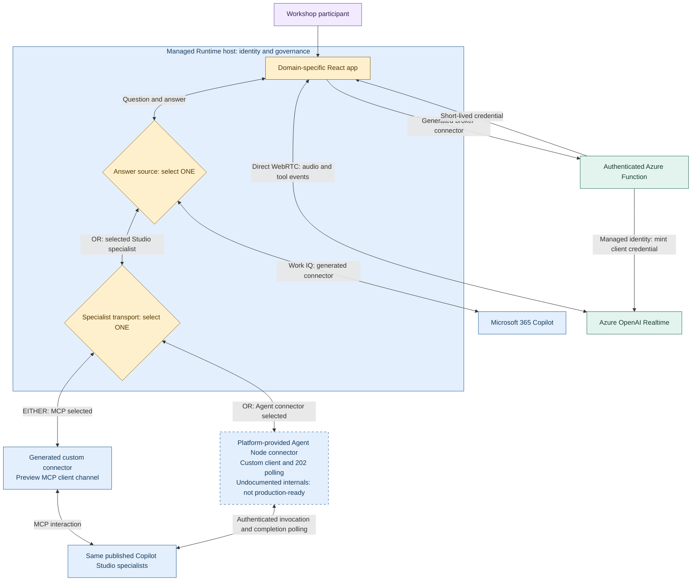
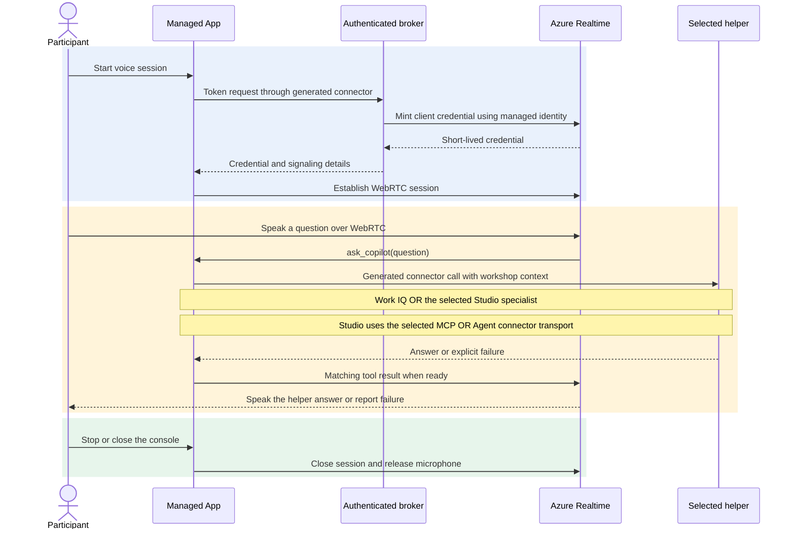

# DFMEA Workshop Studio

**A sample showing how Managed Apps, Copilot Studio and realtime voice can work together.**

Imagine a team reviewing a product design. They work in a focused application, ask a specialist for ideas, consult Microsoft 365 context when useful, and speak to the same selected helper without leaving the workshop.

This repository explores that possibility through a fictional **Design Failure Mode and Effects Analysis (DFMEA)** workshop: a structured way to discuss what could fail, its effects and how to reduce the risk. DFMEA is the example, not a requirement. The integration ideas can support other domain-specific workflows.

## What this demonstrates

| Capability | In this example |
|---|---|
| A purpose-built workspace | A seven-step workshop, product structure, failure chains, ratings and improvement actions |
| Selectable AI helpers | Microsoft 365 Copilot through the sample's Work IQ connector, or one of three Copilot Studio specialists |
| Two specialist invocation paths | A runtime **MCP \| Agent connector** toggle; exactly one transport handles each specialist request |
| Optional work context | Microsoft 365 file search on the Work IQ route, subject to the user's access |
| Conversational voice | Azure OpenAI Realtime carries the conversation; the selected helper supplies the answer |
| Human control | People choose ratings, review suggestions and decide what enters the model |
| Managed integration | Generated connectors, user identity, an authenticated voice broker and platform governance |

This is an integration showcase, **not a production-ready turnkey solution** or an anonymously accessible demo. Cloning the code does not provision its services or reproduce a tenant's connections.

This branch implements the dual-transport preview. Both paths are present for comparison; that is not a live deployment or a claim of verified hosted agent, microphone or playback behavior.

## How the technologies fit together

| Technology | Responsibility |
|---|---|
| Microsoft Copilot Managed Apps / Managed Runtime | Hosts the application, provides identity and routes generated connector calls through platform governance |
| React application | Owns the workshop UI, human review and the manually selected helper |
| Microsoft 365 Copilot / Work IQ route | Answers general workshop questions, optionally grounded in accessible Microsoft 365 content |
| Copilot Studio | Runs the published specialist selected by the user: failure modes, risk prioritization or corrective actions |
| Azure Function broker | Authenticates token requests and uses managed identity to obtain a short-lived Realtime client credential |
| Azure OpenAI Realtime | Provides the speech interface and calls back into the app to consult the selected helper |

Work IQ and Copilot Studio are **alternative answer sources**, not an agent-to-agent chain. The app does not silently substitute another helper. Realtime is instructed to call `ask_copilot` for user questions, wait for the selected helper and speak its answer rather than invent a separate DFMEA answer.

### Copilot Studio invocation: either MCP or Agent Node

**For a Copilot Studio specialist, choose EITHER its MCP publishing channel OR the platform-provided Agent Node connector with custom client/polling code.** These are alternative invocation paths, not two steps in the same request. This is separate from choosing Work IQ versus a Studio specialist as the answer source.

Select a specialist in the helper picker to reveal **MCP | Agent connector**. MCP is the default specialist transport. The toggle is hidden for Work IQ and disabled while a helper request is busy. Changing it stops voice/read-aloud, clears output and starts a fresh conversation; typed and voice questions then use the chosen route. There is no automatic transport fallback.

| Approach | Implementation and limits |
|---|---|
| **MCP interaction — default specialist route** | A generated custom connector invokes the published specialist's **preview MCP client channel**. That channel requires an **early release cycle environment**, user access and delegated Entra OAuth with `MCS.InvokeAsMCP`. The app waits **30 seconds**, including MCP setup and the answer; a timeout does not cancel the upstream request, and automatic retries are disabled. This is the sample's limit, not a universal MCP protocol timeout. |
| **Agent connector — experimental alternative** | The platform-provided Agent Node binding and custom client code perform authenticated invocation and **HTTP 202 completion polling**, with an app-side **three-minute deadline** that does not cancel upstream work. A post-submission failure with an unknown outcome requires **New conversation** before another request. **SDK-channel interception and raw host polling rely on undocumented internals: this workaround is not a supported or production-ready contract.** See the [transport details](docs/technical-guide.md#agent-connector-with-custom-polling). |

**Agent Node is not the standard Copilot Studio `ExecuteCopilotAsyncV2` action.** That action explicitly rejects this sample's GitHub Copilot harness agents. Microsoft documents the [standard connector action](https://learn.microsoft.com/en-us/power-apps/developer/code-apps/how-to/connect-to-copilot-studio) and the [harness-dependent automation restriction](https://learn.microsoft.com/en-us/power-automate/call-copilot-studio-agent) separately. The Agent Node preview must not be read as evidence that the standard action supports them, or that all platform connectors have the same capabilities.

The architecture shows both bindings in this preview, but **only the selected specialist transport sends the request**. The sequence below shows the shared voice interaction: the transport choice changes only the specialist call, not the Work IQ route or Realtime speech interface. Evaluate each route's availability, authentication and limits separately.

## What happens when someone speaks

Opening the voice console does not acquire the microphone. The user explicitly starts the session.

The broker is not an audio relay: the browser connects directly to Azure over WebRTC. The app keeps the credential in memory only. Stop, dialog dismissal, helper changes and transport changes end the voice session; changing helper or transport requires a new explicit Start.

## What needs to be available

These are integration prerequisites, not services supplied by this repository. Preview availability, licensing and policy can change; check the linked Microsoft guidance for your tenant.

| Area | Prerequisite |
|---|---|
| Managed Apps | An eligible tenant, a **Managed Environment** for deployment, app sharing/environment access, and an eligible runtime license or Copilot Credits. The Managed Runtime SDK is documented as preview. [SDK and licensing][runtime] · [Security requirements][security] |
| Copilot Studio specialists — either approach | Published agents that users can access, appropriate Copilot Studio capacity, and the bindings, connections and permissions for the **chosen invocation approach**. MCP and Agent Node are alternatives, not cumulative requirements. |
| MCP channel — only if choosing MCP | The preview **MCP client** channel in an **early release cycle environment**. An ordinary sandbox or an environment named "Preview" is not sufficient. [Channel requirements][studio] · [Early release][early] |
| MCP authentication — only if choosing MCP | A tenant Entra app registration, delegated `MCS.InvokeAsMCP`, OAuth authorization-code support, the connector's exact redirect URI and consent as required by tenant policy. Endpoint and scope hosts must match the actual channel environment. [Authentication][studio] |
| Agent connector — only if choosing it | Its own generated Agent Node binding, authorized connection, agent/environment access and compatible SDK/host-channel behavior. Verify that connector's availability and authentication separately; MCP-specific channel/scope requirements are not universal. The [custom polling adapter](docs/technical-guide.md#agent-connector-with-custom-polling) is experimental and may fail if the channel cannot be captured safely. |
| Microsoft 365 answer route | An authorized connection, access to the relevant Microsoft 365 content, and the entitlements/billing required by the chosen Copilot/Work IQ surface. This route is not a prerequisite for every specialist. The sample uses a legacy connector; see the boundary below. [Copilot MCP reference][legacy] · [Current Work IQ][workiq] |
| Connectors and governance | Tool-generated app bindings for the selected answer sources and broker. ACP is default-deny for covered connectors/actions and supports MCP server-level blocking. Custom/HTTP connectors need classic DLP where evaluated: mixed mode applies the most restrictive rules; ACP-only ignores classic policies and does not add custom/HTTP coverage. Review the effective environment/group mode with an administrator, not by disabling safeguards. [Generated services][connectors] · [ACP coverage][acp] |
| Azure voice services | An available Realtime model deployment and quota, an Entra-authenticated broker, and broker managed identity with inference permissions on the Azure OpenAI resource. [Realtime availability][realtime] · [WebRTC][webrtc] · [Azure RBAC][rbac] |
| Browser and network | HTTPS, microphone permission, WebRTC and audio-playback support, permitted network routes, and a Managed Runtime CSP allowance for the exact Azure signaling origin. [WebRTC requirements][webrtc] · [CSP][csp] |

**Availability is not one switch.** Managed Runtime SDK preview status and, **if choosing MCP**, Copilot Studio's early-release channel rollout are separate requirements. The app and its specialist agents do not have to share an environment, but each side needs the appropriate access, connections and policies.

**Legacy Microsoft 365 connector boundary:** the UI calls its default helper Work IQ / Microsoft 365 Copilot, but its generated `mcp_m365copilot` binding uses an application-specific Copilot MCP surface. Microsoft's [current reference][legacy] keeps those tools for backward compatibility and advises against them for new projects or production. New development should evaluate [unified Work IQ][workiq]; it is not a drop-in replacement implemented by this sample.

Current unified Work IQ API access uses consumption billing independently of Microsoft 365 Copilot licensing. Confirm the requirements of the exact connector/API you choose rather than treating one Copilot license as a universal prerequisite.

## Build on the idea

**Fork or clone this repository and adapt it to your own use case.** Keep the separation between workspace, answer source and speech interface, or explore a different domain entirely.

Start with the [technical guide](docs/technical-guide.md) for the architecture, data model, connector contracts, voice lifecycle and development checks. Useful entry points:

| Entry point | What to explore |
|---|---|
| [`src/pages/home.tsx`](src/pages/home.tsx) | Workshop interactions and in-memory model |
| [`src/connectors/dfmea-helpers.ts`](src/connectors/dfmea-helpers.ts) | Helper/transport choice, conversations and isolation |
| [`src/connectors/agentnode-transport.ts`](src/connectors/agentnode-transport.ts) | Experimental authenticated invocation and bounded completion polling |
| [`src/hooks/use-realtime-voice.ts`](src/hooks/use-realtime-voice.ts) | WebRTC lifecycle and selected-helper tool callback |
| [`voice-broker/`](voice-broker/) | Short-lived credential broker |
| [`specialist-connector/`](specialist-connector/) | Specialist MCP connector and bounded transport |

Use your own environments, published agents, generated bindings, authentication and voice infrastructure. Some code and connector templates contain example-specific endpoints and IDs; cloning does not configure cross-tenant access or make those identities reusable. The [adaptation notes](docs/technical-guide.md#adapting-the-sample) identify those boundaries without prescribing a deployment.

## Boundaries and responsible use

- The initial product and workshop data are fictional. State is in browser memory and resets on reload; persistence and multi-user collaboration are not implemented.
- Seven-step navigation does not mean every planning, structure-editing or reporting capability is complete.
- AI output needs engineering evidence and human review. The sample is not validated medical-device quality-system software and does not establish regulatory compliance.
- Severity, occurrence and detection use 1–10 ratings. Action priority is team-selected, not derived from an invented or unlicensed handbook table.
- Preview connectors and channels can change. Published source, local tests and historical user acceptance are not a guarantee of current tenant availability, all-agent behavior, voice reliability or latency.
- Historical user-reported typed/voice acceptance is recorded separately in the [deployment-specific handover](docs/HANDOVER.md). It is not a generic setup guide or an independent current-live test.

[runtime]: https://learn.microsoft.com/en-us/microsoft-365/copilot-managed-runtime/developer/apps/?view=o365-worldwide
[security]: https://learn.microsoft.com/en-us/microsoft-365/admin/manage/apps/security-compliance?view=o365-worldwide
[studio]: https://learn.microsoft.com/en-us/microsoft-copilot-studio/agents-experience/publication-channels-mcp-agent-to-agent
[early]: https://learn.microsoft.com/en-us/power-platform/admin/early-release
[legacy]: https://learn.microsoft.com/en-us/microsoft-copilot-studio/mcp-copilot-tools
[workiq]: https://learn.microsoft.com/en-us/microsoft-365/copilot/extensibility/work-iq/
[connectors]: https://learn.microsoft.com/en-us/microsoft-365/copilot-managed-runtime/developer/apps/connect-to-data?view=o365-worldwide
[acp]: https://learn.microsoft.com/en-us/power-platform/admin/advanced-connector-policies
[realtime]: https://learn.microsoft.com/en-us/azure/foundry/openai/concepts/realtime-2
[webrtc]: https://learn.microsoft.com/en-us/azure/foundry/openai/how-to/realtime-audio-webrtc
[rbac]: https://learn.microsoft.com/en-us/azure/ai-foundry/openai/how-to/role-based-access-control
[csp]: https://learn.microsoft.com/en-us/microsoft-365/admin/manage/apps/governance?view=o365-worldwide#content-security-policy
