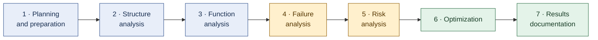
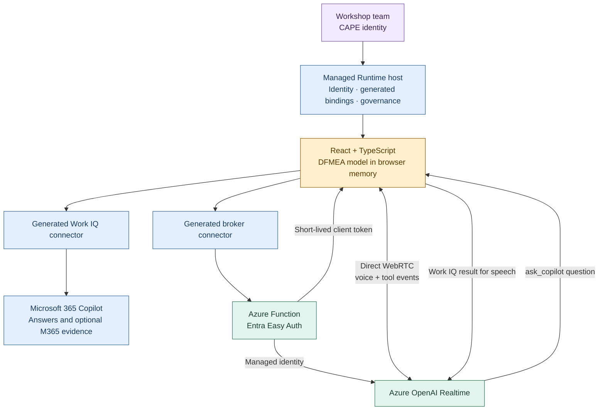
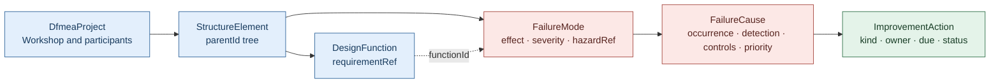
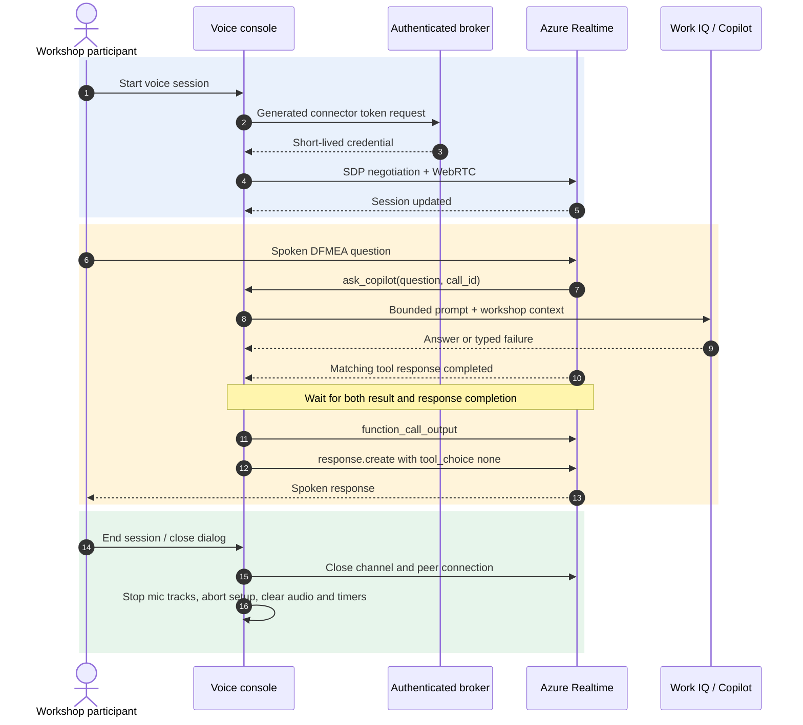
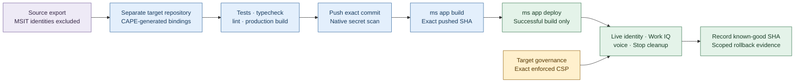

# DFMEA Workshop Studio

**A guided Design Failure Mode and Effects Analysis workshop, with Microsoft 365 Copilot as the facilitator and Azure Realtime as its voice.**

The app brings the AIAG-VDA seven-step workflow, product structure, failure chains, ratings and improvement actions into one screen. A cross-functional design team stays in control: Copilot suggests and challenges; people choose ratings, review suggestions and decide what enters the DFMEA.

[Open the CAPE app](https://play.managedapps.cloud.microsoft/apps/088be080-35da-497a-a83e-0b870c975893) · [Operational handover](docs/HANDOVER.md) · [Voice broker](voice-broker/README.md)

> **Release status:** the dedicated animated voice console is deployed to the CAPE app at commit `12c6ed88787190bceb77602cde62d5908262f4d0` and published to this GitHub repository. The user confirmed typed Copilot and realtime voice on the preceding release; the new console was checked locally, but its hosted audio/Stop behavior has not been independently observed. The operational handover records exact deployment evidence.

## Contents

- [Workshop experience](#workshop-experience)
- [Architecture](#architecture)
- [Data model and ratings](#data-model-and-ratings)
- [Talk to Copilot](#talk-to-copilot)
- [Authentication and security](#authentication-and-security)
- [Local development and checks](#local-development-and-checks)
- [Deployment and cross-tenant migration](#deployment-and-cross-tenant-migration)
- [CSP and troubleshooting](#csp-and-troubleshooting)
- [Repository map](#repository-map)
- [Limitations and responsible use](#limitations-and-responsible-use)

## Workshop experience

| Area | Capability |
|---|---|
| Guided workflow | Seven-step navigation with progress indicators |
| Product structure | System, subsystem and component tree; focus the workshop on an element |
| Failure network | Follow effect → failure mode → cause, with functions and requirements in context |
| Risk analysis | Severity, occurrence and detection ratings; RPN only when all three are rated |
| Improvement actions | Prevention or detection actions, owner, due date and workflow status |
| AI facilitator | Facilitation questions, failure-mode ideas, rating challenges, action suggestions, summaries and free questions |
| Microsoft 365 evidence | Optional file search through the user's CAPE Work IQ context |
| Voice | Browser dictation, read-aloud and a realtime conversational voice console |
| Human review | AI suggestions retain provenance and require team confirmation; voice never mutates the model automatically |



The navigation covers all seven steps, but not every planning, structure-editing or reporting capability is implemented. See [limitations](#limitations-and-responsible-use) and the [backlog](docs/HANDOVER.md).

## Architecture

Built with App Builder and deployed as a **Microsoft Copilot Managed Runtime app**. This is not a Power Apps Code App, a custom Graph application or a Copilot Studio agent conversion.



**Separation of responsibilities**

- **React app:** holds the workshop state, constructs bounded prompts, validates connector results and renders escaped text.
- **Work IQ / Microsoft 365 Copilot:** supplies the answers and, when requested, searches the signed-in user's Microsoft 365 context.
- **Azure Realtime:** handles conversational speech, detects turns and calls `ask_copilot`; it is not an independent DFMEA answer source.
- **Azure Function broker:** authenticates the caller and mints short-lived Realtime client credentials with managed identity.
- **Managed Runtime host:** supplies identity and connector execution, governs access and serves the enforced CSP.

### Technology

React 19 · TypeScript strict · Vite 7 · Tailwind CSS 4 · shadcn/Radix · TanStack Query 5 · Microsoft Managed Apps SDK 0.5.11.

The broker uses Azure Functions, Python 3.12 and managed identity. Dependencies and generated scaffold files are intentionally controlled; adding packages or upgrading the stack requires approval.

## Data model and ratings



- **Severity** belongs to the effect of a failure mode.
- **Occurrence and detection** belong to each cause.
- Ratings use a **1–10 scale**. `RPN = severity × occurrence × detection`, displayed only when every required rating exists.
- **Action priority is selected by the team**, not calculated from an invented threshold or unlicensed handbook table.
- **Workflow status and urgency are separate.**
- AI-suggested records are created with `origin: "ai"` and `reviewed: false`; team review remains explicit.
- Failure effects can reference **ISO 14971 hazards**. A reference is a link for workshop reasoning, not automatic risk-management compliance.

The initial dataset is a fictional wearable vital-signs patch. State is in browser memory and resets on reload. No database or shared persistence is currently wired.

## Talk to Copilot

Select **Talk to Copilot** to open a dedicated, sci-fi-inspired console. Opening it does **not** activate the microphone. Select **Start voice session** to connect.

The animated core uses the app's semantic accent color and follows actual session events. It is not a fabricated audio-level meter.

| Display | Source |
|---|---|
| Ready when you are | No active voice session |
| Establishing voice link | Microphone, token and WebRTC setup in progress |
| Listening | Session configuration acknowledged; ready for a question |
| Hearing you | Realtime speech-start event |
| Processing your question | Realtime speech-stop event |
| Consulting Copilot | An `ask_copilot` tool call is awaiting completion |
| Voice playback active | Realtime output audio buffer is playing |
| Session interrupted | A safe, visible error ended the session |

**End voice session** remains available during setup. Closing the dialog, including Escape or clicking outside it, stops voice. Reopening does not reconnect automatically. Keyboard focus is managed by the existing Radix dialog; reduced-motion and forced-colors modes are supported.

### One question, one answer source



The session-level tool choice requires a tool call for questions. After a Work IQ result, the response-level choice explicitly permits speech without another tool call. This prevents a repeated-tool loop. Call IDs are deduplicated, overlapping tool calls are rejected, and late results cannot resurrect a stopped session.

Work IQ has a **hard 30-second host limit**. Automatic retries are disabled. The UI can explain the limit and keep prompts short; it cannot increase that host timeout. If Work IQ fails, voice reports the failure rather than substituting a model-generated answer.

### Existing speech controls

- **Dictation:** browser Web Speech API inserts text into supported fields.
- **Read-aloud:** browser speech synthesis reads facilitator output.
- **Realtime:** WebRTC voice session through Azure.

These features share audio ownership: starting dictation or read-aloud stops realtime; starting realtime stops competing dictation/synthesis. Browser and language support vary.

## Authentication and security

1. The user signs into the target Managed Runtime host with their CAPE identity.
2. Both connector bindings are generated for the target tenant/environment, not copied from the original MSIT app.
3. The custom broker connector uses Entra authentication. Easy Auth rejects anonymous broker calls with **401**.
4. The Function's managed identity has **Cognitive Services OpenAI User** on the Azure AI resource. Azure local/API-key authentication is disabled.
5. The broker returns a short-lived client credential. The browser validates its expiration, model and exact signaling URL before use.
6. The token exists only transiently in memory: no browser storage, source, logs or retained query cache. The acquisition mutation has `retry: false`, `gcTime: 0` and immediate reset.
7. Voice questions go through Work IQ using the CAPE user's context. No MSIT connection or data fallback is used.

**Untrusted content:** Copilot/connector output is rendered as text, not executable HTML. Suggested rows are validated before entering the model. Raw upstream errors and credentials must never be shown in UI or logs.

### Azure resources

| Resource | Current target |
|---|---|
| Resource group | `rg-dfmea-voice` |
| Azure AI resource | `dfmea-voice-fy27` |
| Realtime deployment | `gpt-realtime-2.1` |
| Function App | `dfmea-voice-broker`, Python 3.12 / Flex Consumption |
| Broker endpoint | `https://dfmea-voice-broker.azurewebsites.net/api/realtime-token` |
| Signaling endpoint | `https://dfmea-voice-fy27.openai.azure.com/openai/v1/realtime/calls` |

The Function requires `AZURE_OPENAI_ENDPOINT` and `AZURE_OPENAI_DEPLOYMENT`. Authentication configuration and connector OAuth credentials belong in the approved platform configuration, never this repository. See the [broker source and OpenAPI](voice-broker/).

## Local development and checks

### Requirements

- Node.js **22 LTS**, compatible with Vite 7.
- npm and the checked-in lockfile.
- Python **3.12** and UV only when working on the broker.
- Managed Runtime access, a Microsoft 365 Copilot entitlement and allowed target connectors for hosted AI/voice.
- Microphone permission and supported WebRTC/audio in the chosen browser for live voice.

```bash
npm ci
npm run dev
# http://localhost:5173
```

Local development supports the workshop UI. **Connector execution requires the Managed Runtime host** (published app or App Builder preview). On localhost the SDK host handshake times out; do not interpret that as a valid hosted connector test.

```bash
node --test tests/*.test.mjs
npm run typecheck
npm run lint
npm run build:check
```

`build:check` validates the production build without writing output. Its POSIX environment syntax requires Git Bash or WSL on Windows. The two existing Fast Refresh warnings in protected scaffold files are known.

Broker checks use an external UV environment so Python-vendored JavaScript is not scanned by the root ESLint command:

```bash
cd voice-broker
UV_PROJECT_ENVIRONMENT=/tmp/dfmea-broker-venv uv run ruff check .
UV_PROJECT_ENVIRONMENT=/tmp/dfmea-broker-venv uv run pytest -q
```

Tests cover cancellation during microphone/token/SDP setup, timeout handling, deduplication, speech continuation ordering, audio ownership, safe failures, token validation and voice-console interactions. Mocked tests do not prove live microphone/audio behavior.

## Deployment and cross-tenant migration

### Current target

| Item | Value |
|---|---|
| Environment | `Managed_App_Deploy` — US Sandbox |
| Environment ID | `28207d24-1fb8-e2ed-ba6e-180550d63611` |
| App ID | `088be080-35da-497a-a83e-0b870c975893` |
| Native repository ID | `d1d3cd61-ab84-4863-b6e2-720b38eee6eb` |
| Baseline deployed commit | `6b8ebc262fea43dd98389e67e109a2f3b6eade2a` |
| Current deployed voice-console commit | `12c6ed88787190bceb77602cde62d5908262f4d0` |
| Release evidence and rollback | [HANDOVER.md](docs/HANDOVER.md) |

The original MSIT app is left untouched. Migration created a new app and native platform repository, new generated connector bindings and target authentication. It did not copy original sharing, credentials or business data.



### Supported release procedure

Use the **Managed Runtime `ms` CLI** and **platform-managed Git/build**, or App Builder. The earlier assumption that only manual App Builder updates were possible was incorrect. Do not use `pac code push` or external-artifact upload for this app.

1. Reuse protected CLI authentication. If sign-in is actually needed, inspect supported device-code options and provide the link without opening a browser automatically.
2. Run `ms app info --json` from the target checkout. Confirm the environment/app before any operation.
3. Add or refresh approved bindings through `ms app add data-source` / `ms app refresh data-source`. These tools generate `generated/` and `ms.config.json`; never hand-write clients.
4. Run checks, review for secrets, commit and push to the target native repository. Ignore `.ms/` tooling caches: schema metadata may contain signed icon URLs. Never bypass the secret scanner.
5. Build and deploy the exact pushed commit, inspecting each result:

   ```bash
   ms app build --commit <full-pushed-sha> --non-interactive --json
   ms app deploy --commit <full-successfully-built-sha> --non-interactive --json
   ms app play --no-browser --json
   ```

6. Verify the platform-reported deployed SHA, typed CAPE Work IQ, real voice response and microphone release on Stop. A successful build or token mint is not a voice smoke test.

The migration used isolated CLI tooling (`@microsoft/managed-apps-cli` 0.32.2) with its required Node runtime, without changing the app's frozen SDK/dependencies. CLI login and native Git use separate authentication clients. Git credentials belong in the protected OS store; configuring a helper does not prove a reusable credential is present.

**GitHub:** the source is published at [Roelzz/code_app_voice](https://github.com/Roelzz/code_app_voice) using the Roelzz account. GitHub is a source publication destination, not the app's deployment binding; the app retains its native Managed Runtime repository.

## CSP and troubleshooting

Managed Runtime enforces CSP on the app document. Direct Azure signaling needs this specific addition:

```text
connect-src 'self' https://dfmea-voice-fy27.openai.azure.com
```

The dedicated environment group is `Managed_App_Deploy_CSP`. Its CSP-only rule retains enforcement and adds only the exact origin. The materialized environment settings were verified as:

```json
{
  "MicrosoftApps_CSPEnabled": true,
  "MicrosoftApps_CSPReportingEndpoint": null,
  "MicrosoftApps_CSPConfig": "{\"Connect-Src\":{\"sources\":[{\"source\":\"https://dfmea-voice-fy27.openai.azure.com\"}]}}"
}
```

These are **Managed Runtime settings**, not Code Apps or classic canvas/model-driven CSP fields. Policy changes require an authorized administrator. Do not disable CSP, use wildcards or change tenant-wide governance to repair one app.

| Symptom | Check |
|---|---|
| `connect-src 'self'` blocks the calls URL | Inspect the actual app document, not only the outer player; saved policy and served policy are separate evidence |
| Settings read returns only `Id` | Use an explicit PAC projection including the MicrosoftApps CSP fields |
| Correct settings but an old policy remains | Reload after propagation; the player supports `?ms_bypassCache=true` for fresh metadata. This is not a service-worker purge or guaranteed fix |
| Broker returns 401 | Expected anonymously; verify Entra connector auth for an authenticated request |
| Token retrieval fails | Verify target broker binding, Easy Auth, managed identity and deployment configuration |
| Voice connects but cannot answer | Check CAPE Work IQ entitlement, allowed operation and hard 30-second host limit |
| Microphone denied / playback blocked | Check the selected browser's microphone and audio permissions |
| Local connector calls time out | Run through the Managed Runtime host; localhost lacks its connector bridge |

Multiple CSP policies intersect; a permissive addition does not override another restrictive policy. An Azure CORS preflight success also does not prove CSP or an authenticated WebRTC connection. Historical diagnosis, policy IDs and task-owned deltas are in the [handover](docs/HANDOVER.md). The user subsequently reported working live voice; no separate governance changes were needed for the visual redesign.

### Rollback

Redeploy a recorded known-good **target** commit through the same native build/deploy flow. For governance, re-read live state and restore only the explicitly task-owned delta, preserving concurrent administrator changes. Never delete apps, data or shared resources as rollback. A code rollback does not automatically restore policy configuration.

## Repository map

| Path | Purpose |
|---|---|
| `src/data/dfmea.ts` | Unified data model, helper functions and initial dataset |
| `src/pages/home.tsx` | Workshop screen, in-memory mutations and generated broker wiring |
| `src/components/dfmea-ui.tsx` | Failure-chain editor, ratings, status/priority tone map |
| `src/components/ai-facilitator.tsx` | Prompt construction, requests, results and human review actions |
| `src/components/voice-console.tsx` | Dedicated animated voice dialog |
| `src/hooks/use-realtime-voice.ts` | WebRTC lifecycle, activity events and Work IQ tool handoff |
| `src/hooks/use-voice.ts` | Dictation, speech synthesis and shared audio ownership |
| `src/connectors/workiq-copilot-chat.ts` | Sole Work IQ transport/parser and typed errors |
| `src/connectors/realtime-token.ts` | Generated broker response validation |
| `src/index.css` | Design tokens and scoped reduced-motion-aware voice animation |
| `generated/`, `ms.config.json` | Tool-generated target identity and connector bindings |
| `voice-broker/` | Azure Function, OpenAPI and Python tests |
| `tests/` | Node/React lifecycle, token and console tests |
| `docs/HANDOVER.md` | Deployment evidence, backlog, governance deltas and rollback |

Read [AGENTS.md](AGENTS.md) and [.github/copilot-instructions.md](.github/copilot-instructions.md) before editing. Generated clients, UI primitives and protected scaffold infrastructure must not be changed manually.

## Limitations and responsible use

- **No persistence or multi-user collaboration yet.** Reloading resets the workshop.
- Planning fields, editable structure/functions and report export remain backlog items.
- AI output can be wrong. Require engineering evidence and team review; do not use generated suggestions as validated safety conclusions.
- This is not validated medical-device quality-system software. Production use requires the organization's validation, risk-management, security and change-control processes.
- AIAG-VDA action-priority/rating tables must come from the team's licensed handbook. The app does not reproduce or invent them.
- CAPE licensing, connector availability, managed-host policies and browser support remain prerequisites.
- The new console is a visual presentation of existing voice activity, not speaker recognition, recording storage or audio analytics.

### References

- [Managed Runtime CLI](https://learn.microsoft.com/en-us/microsoft-365/copilot-managed-runtime/developer/apps/ms-cli-command-reference?view=o365-worldwide)
- [Generated data sources](https://learn.microsoft.com/en-us/microsoft-365/copilot-managed-runtime/developer/apps/connect-to-data?view=o365-worldwide)
- [Managed Runtime governance](https://learn.microsoft.com/en-us/microsoft-365/admin/manage/apps/governance?view=o365-worldwide)
- [Managed Runtime CSP](https://learn.microsoft.com/en-us/microsoft-365/copilot-managed-runtime/developer/apps/content-security-policy?view=o365-worldwide)
