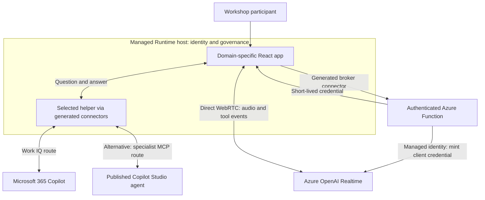
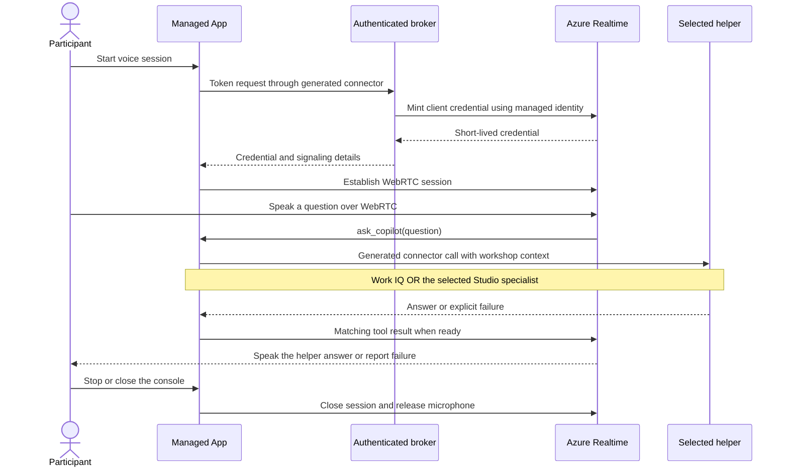

# DFMEA Workshop Studio

**A sample showing how Managed Apps, Copilot Studio and realtime voice can work together.**

Imagine a team reviewing a product design. They work in a focused application, ask a specialist for ideas, consult Microsoft 365 context when useful, and speak to the same selected helper without leaving the workshop.

This repository explores that possibility through a fictional **Design Failure Mode and Effects Analysis (DFMEA)** workshop: a structured way to discuss what could fail, its effects and how to reduce the risk. DFMEA is the example, not a requirement. The integration ideas can support other domain-specific workflows.

## What this demonstrates

| Capability | In this example |
|---|---|
| A purpose-built workspace | A seven-step workshop, product structure, failure chains, ratings and improvement actions |
| Selectable AI helpers | Microsoft 365 Copilot through the sample's Work IQ connector, or one of three Copilot Studio specialists |
| Optional work context | Microsoft 365 file search on the Work IQ route, subject to the user's access |
| Conversational voice | Azure OpenAI Realtime carries the conversation; the selected helper supplies the answer |
| Human control | People choose ratings, review suggestions and decide what enters the model |
| Managed integration | Generated connectors, user identity, an authenticated voice broker and platform governance |

This is an integration showcase, **not a production-ready turnkey solution** or an anonymously accessible demo. Cloning the code does not provision its services or reproduce a tenant's connections.

## How the technologies fit together

| Technology | Responsibility |
|---|---|
| Microsoft Copilot Managed Apps / Managed Runtime | Hosts the application, provides identity and routes generated connector calls through platform governance |
| React application | Owns the workshop UI, human review and the manually selected helper |
| Microsoft 365 Copilot / Work IQ route | Answers general workshop questions, optionally grounded in accessible Microsoft 365 content |
| Copilot Studio | Runs the published specialist selected by the user: failure modes, risk prioritization or corrective actions |
| Azure Function broker | Authenticates token requests and uses managed identity to obtain a short-lived Realtime client credential |
| Azure OpenAI Realtime | Provides the speech interface and calls back into the app to consult the selected helper |

Work IQ and Copilot Studio are **alternative answer sources**, not an agent-to-agent chain. The app does not silently substitute another helper. Realtime is instructed to call `ask_copilot` for user questions, wait for the selected helper and speak its answer rather than invent a separate DFMEA answer.

The code on `main` uses a generated custom connector for the specialists' MCP channels. Separate experimental branches are not the current main implementation or a supported production contract.

## What happens when someone speaks

Opening the voice console does not acquire the microphone. The user explicitly starts the session.

The broker is not an audio relay: the browser connects directly to Azure over WebRTC. The app keeps the credential in memory only. Stop, dialog dismissal and helper changes end the voice session; a helper change requires a new explicit Start.

## What needs to be available

These are integration prerequisites, not services supplied by this repository. Preview availability, licensing and policy can change; check the linked Microsoft guidance for your tenant.

| Area | Prerequisite |
|---|---|
| Managed Apps | An eligible tenant, a **Managed Environment** for deployment, app sharing/environment access, and an eligible runtime license or Copilot Credits. The Managed Runtime SDK is documented as preview. [SDK and licensing][runtime] · [Security requirements][security] |
| Copilot Studio specialists | Published agents that users can access, appropriate Copilot Studio capacity, and the preview **MCP client** channel in an **early release cycle environment**. An ordinary sandbox or an environment named "Preview" is not sufficient. [Channel requirements][studio] · [Early release][early] |
| MCP authentication | A tenant Entra app registration, delegated `MCS.InvokeAsMCP`, OAuth authorization-code support, the connector's exact redirect URI and consent as required by tenant policy. Endpoint and scope hosts must match the actual channel environment. [Authentication][studio] |
| Microsoft 365 answer route | An authorized connection, access to the relevant Microsoft 365 content, and the entitlements/billing required by the chosen Copilot/Work IQ surface. This route is not a prerequisite for every specialist. The sample uses a legacy connector; see the boundary below. [Copilot MCP reference][legacy] · [Current Work IQ][workiq] |
| Connectors and governance | Tool-generated app bindings for the selected answer sources and broker. ACP is default-deny for covered connectors/actions and supports MCP server-level blocking. Custom/HTTP connectors need classic DLP where evaluated: mixed mode applies the most restrictive rules; ACP-only ignores classic policies and does not add custom/HTTP coverage. Review the effective environment/group mode with an administrator, not by disabling safeguards. [Generated services][connectors] · [ACP coverage][acp] |
| Azure voice services | An available Realtime model deployment and quota, an Entra-authenticated broker, and broker managed identity with inference permissions on the Azure OpenAI resource. [Realtime availability][realtime] · [WebRTC][webrtc] · [Azure RBAC][rbac] |
| Browser and network | HTTPS, microphone permission, WebRTC and audio-playback support, permitted network routes, and a Managed Runtime CSP allowance for the exact Azure signaling origin. [WebRTC requirements][webrtc] · [CSP][csp] |

**Availability is not one switch.** Managed Runtime SDK preview status and Copilot Studio's early-release channel rollout are separate requirements. The app and its specialist agents do not have to share an environment, but each side needs the appropriate access, connections and policies.

**Legacy Microsoft 365 connector boundary:** the UI calls its default helper Work IQ / Microsoft 365 Copilot, but its generated `mcp_m365copilot` binding uses an application-specific Copilot MCP surface. Microsoft's [current reference][legacy] keeps those tools for backward compatibility and advises against them for new projects or production. New development should evaluate [unified Work IQ][workiq]; it is not a drop-in replacement implemented by this sample.

Current unified Work IQ API access uses consumption billing independently of Microsoft 365 Copilot licensing. Confirm the requirements of the exact connector/API you choose rather than treating one Copilot license as a universal prerequisite.

## Build on the idea

**Fork or clone this repository and adapt it to your own use case.** Keep the separation between workspace, answer source and speech interface, or explore a different domain entirely.

Start with the [technical guide](docs/technical-guide.md) for the architecture, data model, connector contracts, voice lifecycle and development checks. Useful entry points:

| Entry point | What to explore |
|---|---|
| [`src/pages/home.tsx`](src/pages/home.tsx) | Workshop interactions and in-memory model |
| [`src/connectors/dfmea-helpers.ts`](src/connectors/dfmea-helpers.ts) | Helper choice, MCP conversations and isolation |
| [`src/hooks/use-realtime-voice.ts`](src/hooks/use-realtime-voice.ts) | WebRTC lifecycle and selected-helper tool callback |
| [`voice-broker/`](voice-broker/) | Short-lived credential broker |
| [`specialist-connector/`](specialist-connector/) | Specialist MCP connector and bounded transport |

Use your own environments, published agents, generated bindings, authentication and voice infrastructure. Some code and connector templates contain example-specific endpoints and IDs; cloning does not configure cross-tenant access or make those identities reusable. The [adaptation notes](docs/technical-guide.md#adapting-the-sample) identify those boundaries without prescribing a deployment.

## Boundaries and responsible use

- The initial product and workshop data are fictional. State is in browser memory and resets on reload; persistence and multi-user collaboration are not implemented.
- Seven-step navigation does not mean every planning, structure-editing or reporting capability is complete.
- AI output needs engineering evidence and human review. The sample is not validated medical-device quality-system software and does not establish regulatory compliance.
- Severity, occurrence and detection use 1–10 ratings. Action priority is team-selected, not derived from an invented or unlicensed handbook table.
- Preview connectors and channels can change. Published source, local tests and historical user acceptance are not a guarantee of current tenant availability, all-agent behavior, voice reliability or latency.
- Historical user-reported typed/voice acceptance is recorded separately in the [deployment-specific handover](docs/HANDOVER.md). It is not a generic setup guide or an independent current-live test.

[runtime]: https://learn.microsoft.com/en-us/microsoft-365/copilot-managed-runtime/developer/apps/?view=o365-worldwide
[security]: https://learn.microsoft.com/en-us/microsoft-365/admin/manage/apps/security-compliance?view=o365-worldwide
[studio]: https://learn.microsoft.com/en-us/microsoft-copilot-studio/agents-experience/publication-channels-mcp-agent-to-agent
[early]: https://learn.microsoft.com/en-us/power-platform/admin/early-release
[legacy]: https://learn.microsoft.com/en-us/microsoft-copilot-studio/mcp-copilot-tools
[workiq]: https://learn.microsoft.com/en-us/microsoft-365/copilot/extensibility/work-iq/
[connectors]: https://learn.microsoft.com/en-us/microsoft-365/copilot-managed-runtime/developer/apps/connect-to-data?view=o365-worldwide
[acp]: https://learn.microsoft.com/en-us/power-platform/admin/advanced-connector-policies
[realtime]: https://learn.microsoft.com/en-us/azure/foundry/openai/concepts/realtime-2
[webrtc]: https://learn.microsoft.com/en-us/azure/foundry/openai/how-to/realtime-audio-webrtc
[rbac]: https://learn.microsoft.com/en-us/azure/ai-foundry/openai/how-to/role-based-access-control
[csp]: https://learn.microsoft.com/en-us/microsoft-365/admin/manage/apps/governance?view=o365-worldwide#content-security-policy
